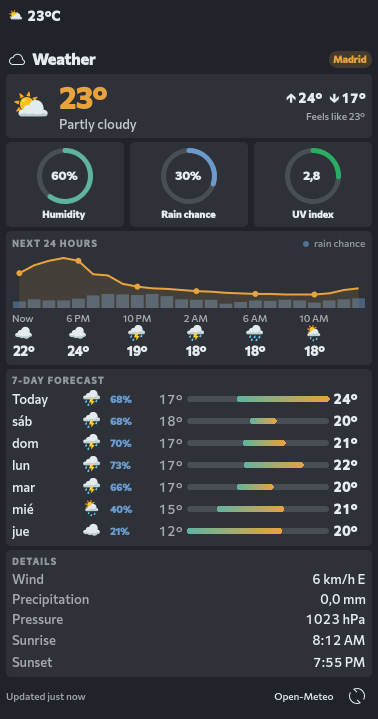

# Simple Weather

A KDE Plasma 6 panel widget that shows the current weather as an emoji and temperature (e.g. `⛅ 23°C`), with a card-style popup in the same look as [System Usage](https://github.com/eepymoonshine/plasma-system-usage). Weather data comes from [Open-Meteo](https://open-meteo.com/), so no API key is needed.



## Features

- **Panel:** weather emoji and temperature. Left-click opens the popup, middle-click refreshes.
- **Popup:** current conditions with feels-like and today's high/low, rings for humidity, rain chance and UV index, a 24-hour temperature chart with rain chance, a 7-day forecast with temperature range bars, and details (wind, precipitation, pressure, sunrise, sunset).
- **Settings:** location search, °C/°F, wind units (km/h, mph, m/s, knots), refresh interval, and the panel's emoji, unit and font.

## Install

```sh
kpackagetool6 -t Plasma/Applet -i package
```

Update after making changes:

```sh
kpackagetool6 -t Plasma/Applet -u package
plasmashell --replace &
```

Then right-click the panel → **Add Widgets** → search for **Simple Weather**, and pick a location in its settings.

## Requirements

- Plasma 6
- A color emoji font (e.g. Noto Color Emoji) for the emoji to show in color

## Credits

Weather data by [Open-Meteo.com](https://open-meteo.com/) (CC BY 4.0).

## License

GPL-3.0-or-later. `UsageRing.qml` is adapted from the Claude Usage plasmoid by izll and Hody (GPL-3.0-or-later).
